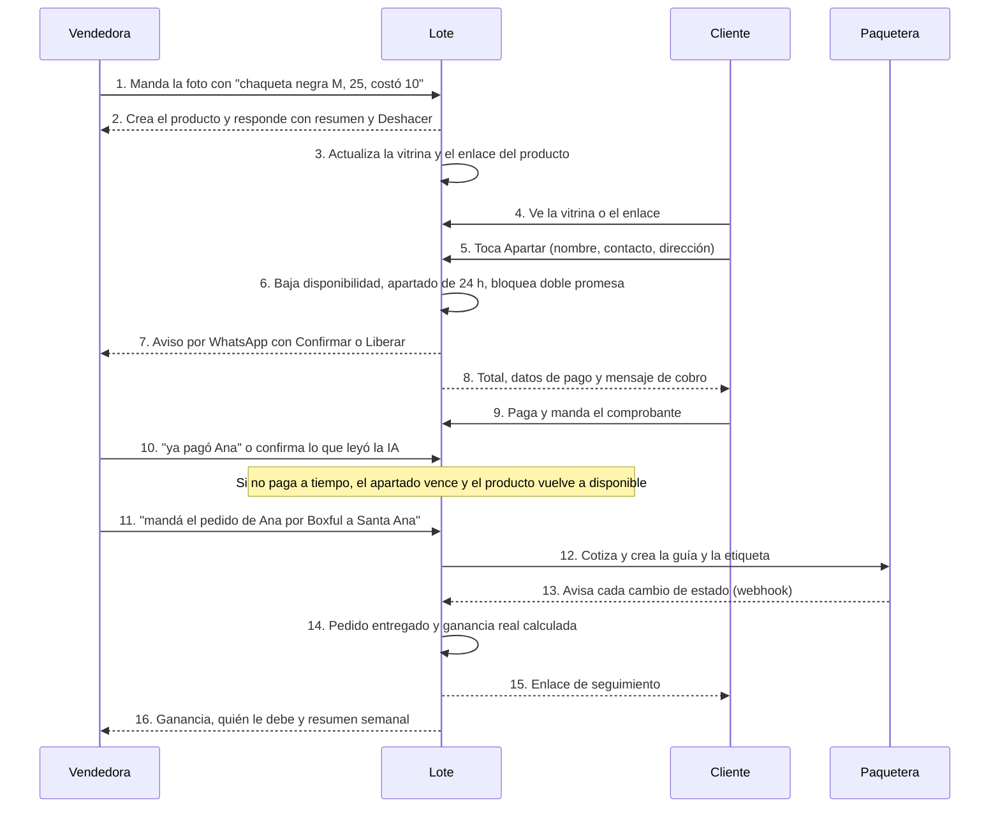
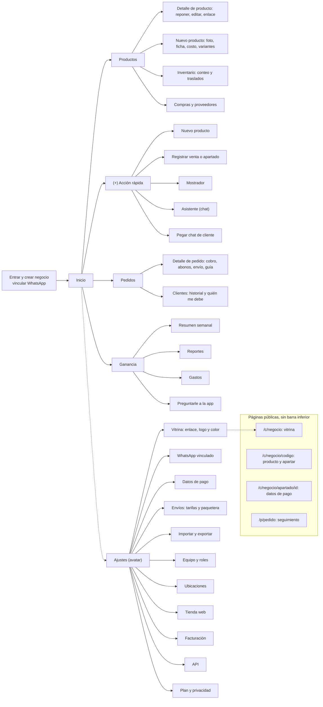
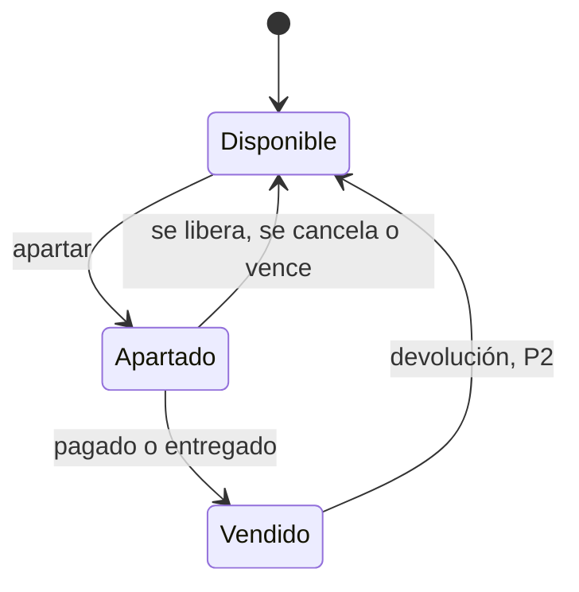
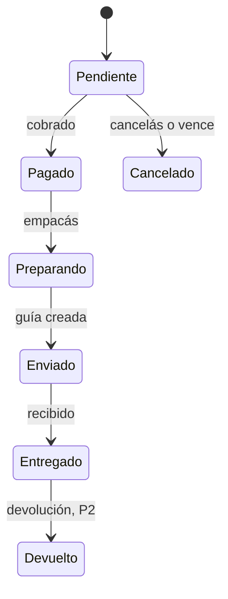
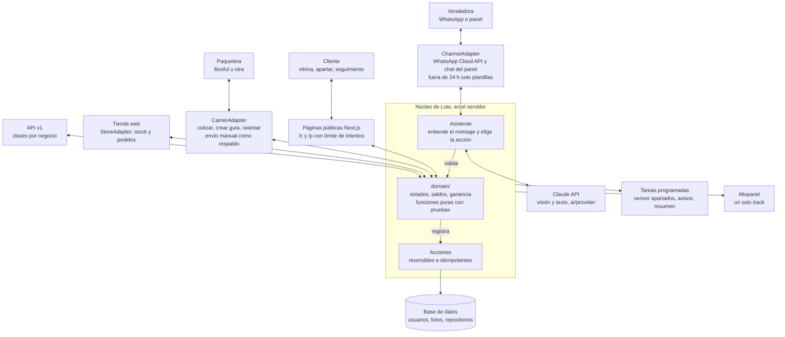

# Lote — especificación base de la app

> Este archivo es la fuente de verdad del producto. Claude Code lo lee antes de construir cualquier cosa. Si algo no está acá, se pregunta; no se inventa.
> Nombre: **Lote**. Viene de cómo compran los emprendedores entrevistados (lotes pequeños de ropa, tandas de piezas). "La app" = Lote. El nombre vive en un solo archivo de textos para poder cambiarlo fácil.
> Ojo: en El Salvador "lote" también es un terreno. Por eso el logo, el eslogan y los textos siempre lo acompañan de productos, nunca de bienes raíces. Eslogan de trabajo: "Tu inventario, apartado y cuadrado."

## 1. Qué es

Un asistente para emprendedores que venden por redes sociales (Instagram, Facebook, WhatsApp). Se maneja **por chat de WhatsApp** (sin abrir otra app), y tiene un **panel web/PWA** para ver y corregir, y una **vitrina pública** con enlace que se actualiza sola.

Cada producto tiene su ficha con cantidad, estado, costo real y ganancia. Una pieza única es un producto con cantidad 1; un producto normal es el mismo con cantidad N. Los pedidos cubren todo el camino: apartado (también desde la vitrina, sin que el cliente tenga que escribirte), cobro con abonos, envío con paquetera y entrega. La IA evita el doble registro: lee fotos, mensajes y comprobantes, y registra o propone la acción.

Propuesta de valor: "Saber en todo momento qué tenés, qué está apartado y cuánto ganás con cada producto, sin llevar el control dos veces."

Referencia: Treinta (ventas, inventario, fiados, catálogo, reportes), adaptada a Instagram, a piezas únicas y con IA.

Usuario principal: emprendedor joven que vende por redes sociales desde el celular (Ternuritos, Koa, Capo). Siguiente etapa: negocios con local y equipo (Mims, MG Vinyls); ver la sección 18 sobre cómo crece Lote.

## 2. Los cuatro ganchos (por qué alguien la usaría)

Salen de lo que la usuaria dijo que le daría hueva o ganas.

1. **No abrir otra app.** Todo se hace desde WhatsApp, donde ya está.
2. **Se llena sola.** Foto y una línea crean el producto; el chat y los comprobantes registran lo demás.
3. **Vende más.** Vitrina con enlace siempre al día, enlace por producto, texto listo para publicar.
4. **Se siente como juego.** Resumen semanal estilo "Wrapped", sticker "VENDIDO" para stories, ganancia que sube.

## 3. Principios de producto

- Nunca se pide el mismo dato dos veces. Lo que falta se pregunta después, no antes.
- Registrar algo toma una línea de chat o uno o dos toques.
- Todo se puede deshacer, siempre, con una palabra o un botón.
- La IA propone, la persona confirma lo ambiguo o delicado; lo claro y de bajo riesgo se aplica con "Deshacer". Los números siempre los calcula el código, nunca la IA.
- Mobile first, una mano, pantallas rápidas.
- El estado del producto se actualiza solo al registrar la venta.
- La ganancia se calcula sola con el costo real (si falta, se marca como estimada).
- El cliente puede hacer lo suyo sin escribirte: ver, apartar, pagar y seguir su pedido.
- Gratis para empezar (el plan de pago está en la sección 15).

## 4. Funcionalidades

Prioridad: P0 imprescindible, P1 importante, P2 si sobra tiempo, P3 etapa 3 (negocio con local y equipo). P3 se construye al final, en el orden de la sección 14, y lo que no alcance queda pendiente. Las funciones están agrupadas por el momento de uso, de punta a punta: meter productos, vender, cobrar, mostrar, enviar, cuadrar el dinero y cuidar al cliente.

### 4.1 Meter productos (lo que más fácil tiene que ser)

- **Foto + una línea** (P0): se manda la foto con "chaqueta negra M, 25, me costó 10" y queda la ficha completa. La IA saca nombre, descripción, categoría y talla/tono de la foto; precio y costo salen de la línea.
- **Costo después** (P0): el costo no es obligatorio. Si falta, la app lo pregunta al vender.
- **Cantidad** (P0): "5 llaveros, 3 dólares, costaron 1" crea un producto con cantidad 5. Sin cantidad, es 1.
- **Reponer** (P0): "llegaron 10 más de los llaveros" suma al stock y recalcula el costo promedio.
- **Código corto** (P0): cada producto tiene un código (#12) para nombrarlo sin ambigüedad.
- **Marca, categoría y condición** (P1): marca y categoría para reportes; condición (nuevo o usado) con una nota del estado de conservación, que sigue a esa pieza específica (caso MG Vinyls).
- **Código de barras** (P3): escanear o asignar un código de barras a un producto (ver 4.11).
- **Importar lo que ya tenés** (P0): ver 4.8.
- **Lote de fotos** (P1): 10 fotos con "lote, costó $60 en total" crea 10 productos y reparte el costo.
- **Repetir producto** (P1): "otra igual" o "como la anterior" copia precio, costo y categoría.
- **Variantes** (P1): un producto con opciones (talla, tono, color), cada una con su stock. Un solo nivel, sin combinaciones.
- **Audio** (P2): hablar en vez de escribir (transcripción en el servidor).
- **Desde un post de Instagram** (P2): compartir la publicación para crear el producto. Depende de lo que Instagram permita.

### 4.2 Vender

- **Apartar, vender, liberar por texto** (P0): "apartá la chaqueta para Ana", "ya pagó", "se cayó el apartado", "vendí 2 llaveros en persona".
- **Deshacer** (P0): cualquier acción se revierte.
- **Bloqueo de doble promesa** (P0): si se quiere apartar algo no disponible, avisa para quién está. Lanza el evento `double_promise_blocked`.
- **Pedidos con estados** (P0): pendiente, pagado, preparando, enviado, entregado, cancelado. Devuelto (P2) cuando se devuelve un pedido entregado.
- **Pedido con varios productos** (P0): un pedido puede llevar varios productos y cantidades.
- **Reenviar el chat del cliente** (P1): la IA propone las acciones y se confirman con un botón.
- **Apartados que se enfrían** (P1): aviso "Ana apartó la chaqueta hace 3 días y no ha pagado. ¿La liberás?" con plazo configurable.
- **Respuesta sugerida** (P1): mensaje corto en el tono del negocio para "¿sigue disponible?", precio, medidas, envío.
- **Descuentos y combos** (P2): descuento en un pedido (monto o porcentaje) y combos tipo 2x1.

### 4.3 Cobrar

- **Datos de pago del negocio** (P0): en Ajustes se guardan los métodos que acepta (transferencia bancaria con sus datos, billetera móvil, efectivo, contra entrega).
- **Mensaje de cobro** (P0): un toque arma el mensaje con el total (productos + envío), los datos de pago y el plazo, listo para copiar o mandar por WhatsApp.
- **Registrar pago** (P0): pago completo o parcial, con método, fecha y comprobante opcional. Por chat: "Ana pagó $25 por transferencia".
- **Contra entrega** (P0): el pedido sale con el monto a cobrar y se marca pagado al confirmarse la entrega.
- **Abonos y pago en cuotas** (P1): el pedido muestra saldo pendiente y se puede abonar varias veces. Recordatorio de saldo.
- **Comprobante con IA** (P1): captura de la transferencia; la app lee el monto, lo compara con el pedido y propone marcar pagado.
- **Pagos en línea con tarjeta** (P3): ver 4.17.

### 4.4 Mostrar y vender más

- **Vitrina pública** (P0): `/c/[negocio]`, siempre al día. Lo vendido sale, lo apartado se marca, el stock se muestra ("quedan 3").
- **Enlace por producto** (P0): `/c/[negocio]/[codigo]`, para mandar al que pregunta "¿sigue disponible?".
- **Apartar desde la vitrina** (P0): botón "Apartar" en el producto. Pide nombre, WhatsApp o @usuario, la opción si hay variantes, y que acepte que le escriban por WhatsApp. Crea un apartado con plazo (24 horas por defecto, configurable), baja la disponibilidad al instante y muestra al cliente una pantalla con los datos de pago, el total y el tiempo restante. La vendedora recibe un aviso por WhatsApp con botones "Confirmar" y "Liberar". Si no se paga a tiempo, el apartado vence solo y el producto vuelve a estar disponible. Cuidado contra abuso: máximo de apartados activos por contacto, límite de intentos por dispositivo, y la vendedora puede apagar la función.
- **Carrito de varios productos** (P1): apartar varios en un solo pedido.
- **Botón de pedir por chat** (P0): abre WhatsApp o Instagram con el mensaje armado, para quien prefiera escribir.
- **Texto sugerido para el post** (P1): al crear un producto, deja listo el texto para publicar.
- **Sticker "VENDIDO"** (P1): imagen generada con la foto del producto para las stories.

### 4.5 Dinero

- **Ganancia por producto, por pedido y por semana** (P0), marcada como estimada si falta el costo.
- **Costo real** (P0): compra, envío, importación, otros. Con reparto del envío entre varios productos (caso Capo).
- **Gastos generales** (P0): empaque, publicidad, transporte, local, comisiones, otros. Se registran por chat ("gasté $5 en bolsas") o con un formulario corto, con categoría y fecha. Un gasto puede ligarse a un pedido (ej. el empaque de ese pedido).
- **Ganancia real** (P0): la pantalla muestra dos números: "Ganancia de productos" y "Ganancia después de gastos". Ver la fórmula en la sección 10.
- **Gastos recurrentes** (P2): alquiler, plan de datos, suscripciones.
- **Precio sugerido** (P1): con el costo y el margen deseado, propone un precio.
- **Resumen semanal estilo Wrapped** (P1): lo vendido, el mejor producto, lo apartado, la ganancia.
- **Preguntas en lenguaje natural** (P1): "¿cuánto gané con la chaqueta?", "¿qué tengo apartado?", "¿quién me debe?".
- **Poco stock** (P1): aviso cuando un producto baja de un número que la persona elige (por defecto 2).
- **Productos dormidos** (P2): los que llevan más de 30 días sin moverse.
- **Gastos de feria o evento** (P2).

### 4.6 Envíos

- **Datos de envío del pedido** (P0): nombre, teléfono, departamento, municipio, dirección y punto de referencia. El cliente los llena al apartar desde la vitrina, o la vendedora pega el texto del chat y la IA lo acomoda en los campos.
- **Modo de entrega** (P0): retiro en persona, entrega propia o paquetera.
- **Costo de envío** (P0): tarifa por departamento configurable en Ajustes (con una tarifa por defecto), y quién lo paga: el cliente, la vendedora o a medias. Lo que paga el cliente se suma al total del cobro; lo que absorbe la vendedora cuenta como gasto del pedido.
- **Envío manual con paquetera** (P0): se registra la empresa y la guía ("ya la envié, guía 123"), y se copia el mensaje con el enlace de seguimiento.
- **Paquetera integrada** (P1): el envío se cotiza, se crea y se rastrea desde la app, sin salir de ella. Se hace detrás de una interfaz `CarrierAdapter` con cuatro operaciones: cotizar, crear envío (guía y etiqueta), consultar estado y recibir actualizaciones por webhook. Primer adaptador: **Boxful**, sujeto a conseguir acceso a su API o una alianza; si no se consigue, otra paquetera con API. El adaptador manual de arriba queda siempre como respaldo. Los datos concretos de cada API se confirman antes de construir; no se inventan.
- **Etiqueta o guía imprimible** (P1): se descarga desde el detalle del pedido.
- **Contra entrega con paquetera** (P1): el pedido lleva el monto a cobrar y se concilia cuando la paquetera liquida.
- **Seguimiento público** (P1): `/p/[pedido]`, donde el cliente ve el estado sin escribir (caso de Capo). El estado se actualiza solo si la paquetera está integrada.
- **Aviso automático al cliente** (P2): mensaje de WhatsApp con plantilla cuando el pedido sale, si el cliente aceptó recibirlos.

### 4.7 Clientes, fiado y postventa

- **Ficha de cliente** (P1): se crea sola al apartar o vender. Nombre, contacto, historial, total comprado, saldo y notas (ej. talla).
- **Fiado** (P1): entregar un pedido con saldo pendiente. La lista "quién me debe" suma lo por cobrar.
- **Devoluciones y cambios** (P2): devolver unidades al stock o descartarlas, reembolsar total o parcial, o cambiar por otro producto. Ajusta ventas y ganancia.
- **Clientes frecuentes** (P2): aviso cuando llega algo de la categoría que ese cliente suele comprar.
- **Consignación** (P2): producto con dueño externo y porcentaje de comisión; la app calcula lo que se le debe a quien lo dio.

### 4.8 Importar y exportar

- **Importar CSV o Excel** (P0): se sube el archivo, la IA propone a qué campo corresponde cada columna (nombre, precio, costo, cantidad, estado, cliente), se muestra una vista previa con los errores marcados, y al confirmar se crea todo como un lote. Con plantilla descargable.
- **Deshacer una importación** (P0): se revierte completa con un botón.
- **Importar desde Google Sheets** (P1): pegando el enlace de la hoja.
- **Importar desde foto o captura de notas** (P2): la IA lee un cuaderno o una nota del celular y propone las filas.
- **Exportar** (P1): productos, pedidos, gastos y clientes a CSV, para que nadie sienta que queda atrapado.

### 4.9 Panel web / PWA (secundario)

Para ver y corregir, no para trabajar ahí. Lista de productos, pedidos, clientes, ganancia, gastos y ajustes. Versión mínima en P0.

### 4.10 Equipo y roles (P1 ayudante, P3 el resto)

- **Invitar personas** (P1): por enlace o por número de WhatsApp. Cada persona tiene un rol.
- **Roles** (P1): dueña, administradora, vendedora y solo lectura.

| Acción | Dueña | Administradora | Vendedora | Solo lectura |
|---|---|---|---|---|
| Ver productos y precios | sí | sí | sí | sí |
| Registrar ventas, apartados y pagos | sí | sí | sí | no |
| Editar productos y precios | sí | sí | no | no |
| Ver costos y ganancia | sí | sí | no | no |
| Compras, proveedores y gastos | sí | sí | no | no |
| Reportes de ventas sin costos | sí | sí | sí | sí |
| Reportes con costos y ganancia | sí | sí | no | no |
| Exportar datos | sí | sí | no | no |
| Equipo, ajustes, plan y API | sí | no | no | no |

- **Asistente por WhatsApp para cada persona** (P1): cada miembro vincula su número y el asistente respeta su rol (a una vendedora no le responde costos ni ganancias).
- **Quién hizo qué** (P1): cada acción guarda a la persona que la hizo.
- **Atendiendo a** (P2): el pedido muestra quién está atendiendo a cada cliente, para no dar respuestas distintas (caso Mims).
- **Actividad por persona** (P2): lista de acciones y ventas de cada miembro.
- **Quitar acceso** (P1): la dueña puede sacar a alguien al instante.

### 4.11 Mostrador o punto de venta (P3)

- **Pantalla Mostrador:** pensada para vender en persona. Búsqueda por nombre, código o código de barras, carrito, cantidad, descuento, método de pago y cobrar. Una venta en tres toques.
- **Código de barras:** escanear con la cámara del celular o con un lector USB o Bluetooth (funciona como teclado). Al escanear un código nuevo, se ofrece asociarlo a un producto. Imprimir etiquetas con código de barras.
- **Recibo:** digital por WhatsApp o imprimible.
- **Cierre de caja:** se abre con el efectivo inicial. Al cerrar muestra las ventas en efectivo, las transferencias, los gastos del día y la diferencia contra lo contado.
- **Sin internet:** se puede seguir vendiendo y se sincroniza al volver la conexión.
- Una venta de mostrador descuenta de la existencia de su ubicación y crea un pedido entregado y pagado (origen `mostrador`).

### 4.12 Ubicaciones, inventario y traslados

- **Varias ubicaciones** (P3): casa, local, bodega, feria. Cada una tiene su propia existencia y se marca si su stock se vende en línea.
- **Traslados** (P3): "pasá 10 llaveros del local a la bodega", por chat o pantalla, con historial.
- **Conteo de inventario** (P2): se cuenta una ubicación a mano o escaneando, la app muestra las diferencias contra el sistema y ajusta con un motivo (merma, error, hallazgo). Cada ajuste queda registrado. Es lo que hace que el sistema refleje lo que realmente hay.
- **Disponibilidad en la vitrina:** suma de las existencias de las ubicaciones vendibles en línea.

### 4.13 Compras y proveedores (P3)

- **Proveedores:** nombre, contacto, notas e historial de compras.
- **Registrar una compra:** proveedor, productos y cantidades, costo por producto, envío e impuestos (se reparten entre los productos) y fecha. Al recibirla, suma a la existencia y actualiza el costo promedio con las mismas reglas de reponer. Por chat: "llegó el pedido de Capo: 10 llaveros a $1 y $5 de envío".
- **Cuentas por pagar:** compra con saldo pendiente y abonos al proveedor.
- **Historial de precios de compra** por producto.
- **Reposición sugerida:** lista de lo que conviene pedir según ventas, vistas de la vitrina y poco stock. Los números los calcula el código; la IA solo lo redacta.

### 4.14 Reportes (P2 básicos, P3 completos)

- **Por producto, categoría, marca, canal, cliente y periodo** (P2): ventas y ganancia.
- **Lo más vendido de la semana** por producto, marca y categoría (P2, caso Mims).
- **Interés contra ventas** (P2, caso MG Vinyls): productos con muchas vistas o consultas y pocas ventas.
- **Margen por categoría y por marca** (P3).
- **Por ubicación y por persona** (P3).
- **Inventario valorizado** (P3): cuánto dinero hay parado en stock, a costo.
- **Exportar** cualquier reporte a CSV (P2).

### 4.15 Tienda web, API y otras conexiones (P3)

- **`StoreAdapter`:** conecta una tienda en línea. Primero la que use MG Vinyls (a confirmar; candidatas Shopify y WooCommerce).
- **Lote es la fuente de verdad del inventario:** cuando algo se vende en cualquier canal (tienda web, mostrador, Instagram), baja en todos. Los pedidos de la tienda web entran como pedidos de Lote.
- **Conflictos:** si se vende lo mismo en dos canales casi a la vez, gana el primer pedido registrado y a la persona del otro se le avisa al instante.
- **API y webhooks:** API REST en `/api/v1` con claves por negocio (permiso de lectura o escritura) y webhooks salientes (pedido creado, stock cambiado).
- La sincronización inicial se hace con la importación.

### 4.16 Facturación electrónica (P3)

- **Emitir comprobantes electrónicos** válidos ante la autoridad tributaria de El Salvador desde un pedido, con los datos fiscales del negocio y del cliente. Los requisitos concretos (formatos, firma, transmisión, proveedor autorizado) se confirman con la normativa vigente y con un contador antes de construir; no se asumen.
- **Una factura emitida no se edita:** se anula o se corrige con otro documento.
- **Numeración, historial y exportación** para el contador.
- Paso previo (P2): datos fiscales del negocio y número de comprobante manual en el pedido.

### 4.17 Pagos en línea (P3)

- **Enlace de pago** para cobrar con tarjeta o billetera desde el mensaje de cobro. El proveedor se define según disponibilidad y comisiones en El Salvador. Al confirmarse el pago, el pedido pasa a pagado.

### 4.18 Fuera de alcance

Lectura automática de DMs de Instagram (depende de lo que permita su API), app nativa, modo oscuro y combinaciones de variantes (talla por color).

## 5. Asistente por chat

Es el corazón del producto. Un solo motor (`features/assistant`) recibe un mensaje, lo entiende, ejecuta la acción y responde. Los canales son adaptadores intercambiables:

- **WhatsApp** (canal principal). Para la demo: número de prueba de la API de WhatsApp Cloud de Meta o sandbox de Twilio. Producción requiere verificación del negocio en Meta.
- **Chat dentro del panel** (respaldo y misma lógica). Si WhatsApp no está disponible, el chat del panel funciona igual. Se construye primero.

Un `ChannelAdapter` define: recibir mensaje (texto, imagen, audio), enviar respuesta (texto, botones). Nada fuera del adaptador sabe qué canal es.

### 5.1 Intenciones

| Intención | Ejemplo | Resultado |
|---|---|---|
| crear_producto | foto + "chaqueta negra M, 25, costó 10" | Crea ficha, responde con resumen y enlace |
| crear_lote | 10 fotos + "costó $60 en total" | Crea N productos con costo repartido |
| reponer | "llegaron 10 más de los llaveros" | Suma stock y recalcula costo promedio |
| apartar | "apartá la chaqueta para @ana" | Producto o unidades pasan a apartadas |
| vender | "vendí 2 llaveros en persona, efectivo" | Crea pedido entregado y calcula ganancia |
| marcar_pagado | "ya pagó Ana" | Pedido a pagado, producto a vendido |
| liberar | "se cayó el apartado de Ana" | Vuelve a disponible |
| enviar | "ya la envié, guía 123" | Pedido a enviado con seguimiento |
| cobrar | "cobrale a Ana" | Arma el mensaje de cobro con total, datos de pago y plazo |
| abonar | "Ana abonó $10" | Registra el abono y muestra el saldo |
| gasto | "gasté $5 en bolsas" | Registra un gasto del negocio |
| crear_envio | "mandá el pedido de Ana por Boxful a Santa Ana" | Cotiza y crea la guía con la paquetera, o registra una guía manual |
| devolver | "Ana devolvió la chaqueta" | Devuelve al stock y ajusta ventas y ganancia |
| trasladar | "pasá 10 llaveros del local a la bodega" | Mueve existencia entre ubicaciones |
| comprar | "llegó el pedido de Capo: 10 llaveros a $1 y $5 de envío" | Registra la compra, suma existencia y actualiza el costo promedio |
| consultar | "¿qué tengo apartado?", "¿cuánto gané esta semana?" | Respuesta solo lectura |
| deshacer | "deshacer" | Revierte la última acción |
| ayuda | "ayuda" | Lista corta de lo que se puede decir |

### 5.2 Reglas del asistente

- **Resolución de producto:** por código (#12) o por nombre aproximado. Si coinciden varios, pregunta con una lista numerada. Nunca adivina entre dos.
- **Qué se aplica solo y qué se confirma:** lo claro y de bajo riesgo se aplica y responde con "Deshacer". Se pide confirmación cuando: hay ambigüedad, falta el cliente en un apartado, es una cancelación, o viene de un chat reenviado o de un comprobante.
- **Respuestas cortas, siempre con el estado resultante:** "Listo. Chaqueta negra apartada para @ana. Disponibles: 0." Con botón "Deshacer".
- **Datos que faltan:** se pregunta uno solo, el más importante, y se ofrece "después".
- **Costo faltante:** al vender un producto sin costo, pregunta "¿Cuánto te costó?" con opción de saltar.
- **Idempotencia:** el mismo mensaje procesado dos veces no duplica la acción (se guarda el id del mensaje).
- **Solo el dueño:** el número de WhatsApp debe estar vinculado a un negocio. Números desconocidos reciben una invitación a crear cuenta.
- **Registro:** cada mensaje y acción queda en `accion` con su resultado para poder deshacer y para analítica.

### 5.3 Mensajes fuera de las 24 horas (límite de WhatsApp)

WhatsApp Business solo deja responder libremente dentro de las 24 horas siguientes al último mensaje de la persona. Fuera de esa ventana solo se pueden mandar **plantillas aprobadas por Meta**. Esto afecta todo lo que la app dice por iniciativa propia:

- Plantillas a definir y mandar a aprobar desde el inicio: `apartado_nuevo` (aviso a la vendedora cuando alguien aparta desde la vitrina), `apartado_por_vencer`, `apartado_vencido`, `resumen_semanal`, `pedido_enviado` (al cliente), `recordatorio_abono`.
- Si la ventana está abierta se manda un mensaje normal; si no, la plantilla.
- Los avisos se disparan con tareas programadas (cron): vencer apartados, recordar apartados fríos y abonos, y mandar el resumen semanal.
- A un cliente final solo se le escribe si aceptó al apartar (casilla de consentimiento).

## 6. Estilo y colores

Tono: cálido, juvenil y con carácter. Teal profundo para dar confianza, y rosa y ámbar para darle personalidad. Mucho aire y la foto del producto como protagonista.

Paleta:
- Dark Teal `#003844`
- Stormy Teal `#006C67`
- Pink Mist `#F194B4`
- Amber Flame `#FFB100`
- Pearl Beige `#FFEBC6`

Cómo se usa:
- Fondo: `#FFF7E8`
- Superficie (tarjetas): `#FFFFFF`
- Texto: Dark Teal
- Texto secundario: `#4A6B73`
- Primario (botones, pestaña activa, enlaces): Stormy Teal, con texto blanco
- Acento: Amber Flame para el botón "+" (ícono en Dark Teal)
- Pink Mist: acento de marca en detalles, ilustraciones, estados vacíos y el chip "Sugerido" de lo que propone la IA
- Pearl Beige: fondos de chips y de bloques destacados
- Bordes y divisores: `#EADFC8`

Contraste: Pink Mist y Amber Flame no sirven para texto sobre claro. Se usan como relleno, con texto o ícono en Dark Teal encima. Para texto de color se usan variantes oscuras (`#7A5200` para ámbar y `#9C3A60` para rosa).

Estados de producto (siempre color + texto + ícono, nunca solo color):
- Disponible: texto `#006C67`, fondo `#DDEFEE`
- Apartado: texto `#7A5200`, fondo `#FFEBC6`
- Vendido: texto `#4A6B73`, fondo `#E6EEEF`
- Poco stock: mismo estilo que apartado, con el texto "Quedan N"

Estados de pedido (con texto e ícono):
- Pendiente: texto `#7A5200`, fondo `#FFEBC6`
- Pagado: texto `#9C3A60`, fondo `#FCE4EC`
- Preparando: texto `#006C67`, fondo `#DDEFEE`
- Enviado: texto `#003844`, fondo `#DCE8EA`
- Entregado: chip lleno en `#006C67`, texto blanco e ícono de check
- Cancelado / error: `#B3261E` (único color fuera de la paleta, reservado para errores)

Todas las combinaciones de texto cumplen contraste de al menos 4.5 a 1.

Modo oscuro: fuera del alcance por ahora.

Tipografía: Plus Jakarta Sans (Google Fonts). Títulos 700, texto 400/500.

Componentes: tarjetas de 16 px de radio, chips redondeados, botones de 48 px de alto, áreas táctiles de al menos 44 px, foto del producto siempre protagonista.

### 6.1 Que no se vea "hecho con IA"

- Sin degradados morados o azules, sin brillos, sin íconos de chispas por todos lados y sin emojis decorativos en la interfaz.
- La IA no es la protagonista: se integra en el flujo. Los botones dicen lo que hacen ("Completar con la foto", "Revisar mensaje"), no "Generar con IA". Lo que propone la IA lleva un chip pequeño "Sugerido" y siempre es editable.
- Sin chatbot flotante y sin "Powered by AI". El chat del panel es una pantalla normal, no un globo.
- Textos en español salvadoreño natural (voseo: "subí", "tenés"), frases cortas, sin frases de relleno ("potencia tu negocio"). Los textos se escriben a mano, también los de estados vacíos y errores, y los mensajes del asistente por WhatsApp.
- Visual simple: la foto manda. Tarjetas con borde o una sola sombra suave (sin glassmorphism), radios y espaciados consistentes, una sola familia tipográfica, ilustraciones mínimas.
- Datos reales en la demo: productos de verdad, con fotos propias. Nada de "Producto 1", lorem ipsum ni fotos de stock.
- Animaciones solo funcionales: transiciones cortas (150 a 200 ms) que confirman una acción.

### 6.2 Accesibilidad

Meta: WCAG 2.2 nivel AA.

- Contraste de texto de al menos 4.5 a 1, y de al menos 3 a 1 en íconos y bordes de controles.
- Nada se comunica solo con color: estados con color, texto e ícono.
- Áreas táctiles de al menos 44 × 44 px, con espacio entre ellas.
- Todo se puede usar con teclado en escritorio, con foco visible (anillo de 2 px en Stormy Teal) y orden lógico. Las hojas inferiores y diálogos atrapan el foco, cierran con Esc y devuelven el foco a quien los abrió.
- HTML semántico (`button`, `nav`, `main`, títulos en orden, listas) y `<html lang="es">`.
- Todo campo tiene su etiqueta visible (no solo placeholder). Los errores se muestran en texto junto al campo y se asocian con `aria-describedby`.
- Confirmaciones como "Producto marcado como vendido" se anuncian con `aria-live`.
- Fotos de productos con `alt` igual al nombre. Las decorativas con `alt=""`.
- Texto en `rem`. El diseño aguanta zoom al 200% y no se bloquea el zoom.
- Respetar `prefers-reduced-motion`.
- Ningún gesto es la única vía: deslizar para cambiar el estado también tiene un botón.
- Probar el flujo principal con lector de pantalla (VoiceOver o TalkBack) y pasar axe o Lighthouse.

## 7. Navegación

Barra inferior con 4 pestañas y un botón central "+":
- Inicio
- Productos
- (+) Acción rápida: nuevo producto / registrar venta / hablar con el asistente / pegar chat
- Pedidos
- Ganancia

Ajustes se abre desde el avatar arriba a la derecha en Inicio. La vitrina pública y el seguimiento público no tienen barra inferior.

Mapa:

    Login → Crear negocio → Vincular WhatsApp → Inicio
    Inicio ─ Productos ─ Detalle de producto ─ Editar producto
          │           ├ Nuevo producto (foto → ficha con IA)
          │           └ Inventario (conteo y traslados) | Compras y proveedores
          ├ (+) ─ Nuevo producto | Registrar venta o apartado | Mostrador | Asistente (chat) | Pegar chat de cliente
          ├ Pedidos ─ Detalle de pedido (cobro y envío) | Clientes
          ├ Ganancia ─ Resumen semanal | Reportes | Gastos | Preguntarle a la app
          └ Ajustes ─ Vitrina (enlace y apariencia) | WhatsApp | Datos de pago | Envíos y paquetera | Importar y exportar | Equipo y roles | Ubicaciones | Tienda web | Facturación | API | Plan y privacidad
    Público: /c/[negocio] (vitrina)  ·  /c/[negocio]/[codigo] (producto y apartar)  ·  /c/[negocio]/apartado/[id] (confirmación con datos de pago)  ·  /p/[pedido] (seguimiento)

### 7.1 Responsive

Prioridad: móvil. Una sola app que se adapta, no dos versiones.

- Móvil (hasta 767 px): barra inferior con pestañas y botón "+". Es la experiencia principal y la que se diseña primero.
- Escritorio (desde 768 px): la barra inferior pasa a un menú lateral. Contenido centrado con ancho máximo (unos 1100 px). Listas con más columnas. Formularios y hojas inferiores se abren como paneles o diálogos centrados.
- Vitrina y seguimiento públicos: cuadrícula de 2 columnas en móvil y de 3 a 4 en escritorio.
- Equipo en un local (P3): el mostrador, los reportes y las compras se usan sobre todo en escritorio, con dos paneles (lista a la izquierda, detalle a la derecha).

## 8. Pantallas

**1. Login y crear negocio.** Entrar con Google o correo. Pide solo nombre del negocio y usuario de Instagram. Después, vincular WhatsApp (código de verificación). Termina en Inicio con un primer paso: "Mandá la foto de tu primer producto".

**2. Inicio.**
- Contadores: disponibles, apartados, vendidos.
- Pedidos que requieren acción (pendiente de pago, por enviar).
- Apartados que se enfrían.
- Ganancia de la semana.
- Accesos rápidos: nuevo producto, registrar venta, hablar con el asistente.
- Estado vacío con una sola acción clara.

**3. Productos.**
- Lista con foto, nombre, código, precio, chip de estado, cantidad disponible y ganancia estimada.
- Búsqueda y filtros por estado.
- Tocar una tarjeta abre el detalle. Un deslizamiento cambia el estado rápido (con botón alternativo).

**4. Nuevo producto.**
- Foto o varias (cámara o galería). La IA propone nombre, descripción y categoría. Se editan.
- Costo en desglose: compra, envío, importación u otros. "Repartir envío entre varios productos" para lotes. Opcional.
- Precio de venta. Ganancia estimada en vivo debajo.
- Cantidad (por defecto 1). Variantes opcionales (talla, tono, color) con stock por variante.
- Guardar crea el producto como disponible.

**5. Detalle de producto.**
- Fotos, código, estado, cantidades (disponibles, apartadas, vendidas), cambio de estado en un toque.
- Costo desglosado, precio y ganancia.
- Pedidos asociados.
- Historial de cambios.
- Botones: reponer, copiar respuesta sugerida, copiar texto para el post, compartir enlace, generar sticker "VENDIDO", editar.

**6. Registrar venta o apartado** (hoja inferior, 1–2 toques).
- Elegir producto (solo los disponibles) y cantidad.
- Cliente (nombre o @usuario), canal (Instagram, WhatsApp, en persona), pago (efectivo, transferencia), apartado o venta.
- Confirmar crea el pedido y actualiza el producto.
- Si no hay disponibilidad: "Ya está apartada para @ana". Esta pantalla evita la doble promesa.

**7. Asistente (chat).** Misma conversación que por WhatsApp, dentro del panel: caja de texto, adjuntar foto, botones de respuesta rápida. Muestra las acciones aplicadas con "Deshacer".

**8. Pegar chat de cliente.**
- Se pega texto de una conversación o se sube una captura.
- La IA propone acciones: "Apartar chaqueta negra para @ana", "Marcar pagado el pedido de @luis".
- Cada acción tiene Confirmar o Descartar. Nada se aplica sin confirmación.

**9. Pedidos.**
- Pestañas por estado: pendiente, pagado, preparando, enviado, entregado.
- Tarjeta con cliente, productos, total y canal.

**10. Detalle de pedido.**
- Cliente, productos, cobro y envío en una sola pantalla.
- Cobro: total, pagos recibidos, saldo, botón "Copiar mensaje de cobro" y "Registrar pago o abono". Método y comprobante.
- Envío: dirección, modo de entrega, costo y quién lo paga, paquetera, guía y estado. Con paquetera integrada: "Cotizar", "Crear envío" y "Descargar etiqueta".
- Avanzar de estado con un botón.
- Botón para copiar el mensaje con el enlace de seguimiento.
- Si vino de la vitrina, muestra el tiempo que le queda al apartado y botones "Confirmar" y "Liberar".

**11. Ganancia.**
- Por periodo (semana, mes): vendido, costo de productos, gastos, ganancia de productos y ganancia después de gastos. Lo por cobrar aparece aparte.
- Ranking de productos por ganancia.
- Aviso si hay ventas sin costo registrado.
- Resumen semanal estilo Wrapped.
- Campo "Preguntale a la app".

**12. Ajustes.** Perfil del negocio, enlace de la vitrina, logo y color, WhatsApp vinculado, datos de pago, tarifas de envío y paquetera, plazo para apartados y límite por contacto, aviso de poco stock, importar y exportar, equipo y roles, ubicaciones, tienda web, facturación, API, plan, privacidad, cerrar sesión.

**13. Vitrina pública** (`/c/[negocio]`).
- Cuadrícula de fotos con precio y chip de disponibilidad en tiempo real ("Disponible", "Apartado", "Quedan 3").
- Los vendidos se ocultan (opción en Ajustes: mostrar como "Vendido").
- Botón "Pedir por WhatsApp / Instagram" que abre el chat con el mensaje armado.
- Presentación cuidada: es parte de lo que venden (Koa y Capo).

**14. Producto público** (`/c/[negocio]/[codigo]`). Fotos, precio, variantes, disponibilidad, "Apartar" y "Pedir por chat". Al apartar: formulario corto (nombre, contacto, variante, dirección de envío si hace falta, casilla para que le escriban por WhatsApp), y luego la pantalla de confirmación con total, datos de pago y tiempo restante.

**15. Seguimiento público** (`/p/[pedido]`). El cliente ve el estado y el número de seguimiento sin escribir al vendedor (caso de Capo).

**16. Clientes.** Lista con búsqueda; ficha con historial de pedidos, total comprado, saldo y notas. Filtro "con saldo pendiente" ("quién me debe").

**17. Gastos.** Lista por periodo y categoría; botón para agregar un gasto en dos campos (monto y categoría).

**18. Importar.** Subir archivo, revisar el mapeo de columnas que propone la app, vista previa con errores marcados, confirmar y opción de deshacer la importación.

**19. Mostrador (P3).** Búsqueda o escaneo, carrito, descuento, método de pago, cobrar, recibo y cierre de caja.

**20. Inventario (P2 conteo, P3 traslados).** Elegir ubicación, contar, ver diferencias y ajustar con motivo. Traslados entre ubicaciones con historial.

**21. Compras y proveedores (P3).** Lista de proveedores, registrar una compra con envío e impuestos repartidos, recibirla, abonos al proveedor, historial de precios y reposición sugerida.

**22. Reportes (P2 y P3).** Filtros por periodo, producto, categoría, marca, canal, cliente, ubicación y persona. Lo más vendido, interés contra ventas, margen e inventario valorizado. Exportar a CSV.

**23. Equipo y roles (P1 y P3).** Invitar, asignar rol, ver actividad por persona y quitar acceso.

**24. Tienda web y API (P3).** Conectar la tienda, ver el estado de la sincronización y los conflictos, crear claves de API y webhooks.

**25. Facturación (P3).** Datos fiscales, emitir desde un pedido, anular y exportar para el contador.

## 9. IA

Principio: la IA propone y la persona confirma lo delicado, y se integra en el flujo sin protagonismo (ver 6.1). Los números siempre los calcula el código; la IA solo redacta sobre números ya calculados.

- **Entender mensaje.** Entrada: texto del chat. Salida: intención y parámetros (JSON validado con zod). No ejecuta nada por sí misma.
- **Foto a ficha.** Entrada: imagen. Salida: nombre, descripción, categoría, talla o tono si se ve. El costo y el precio los pone la persona.
- **Chat de cliente a acciones.** Entrada: texto o captura. Salida: lista de acciones propuestas con producto y cliente. Requiere confirmación.
- **Comprobante.** Entrada: captura de transferencia. Salida: monto, fecha, referencia. El código compara con el pedido.
- **Dirección.** Entrada: texto pegado del chat. Salida: departamento, municipio, dirección, referencia y teléfono en campos, para confirmar.
- **Importación.** Entrada: columnas de un CSV o Excel. Salida: a qué campo corresponde cada una (se confirma antes de crear nada).
- **Respuesta sugerida y texto del post.** Entrada: producto con su estado real. Salida: mensaje corto en el tono del negocio.
- **Preguntas en lenguaje natural.** Solo lectura, con funciones predefinidas (ganancia por producto, productos por estado, pedidos pendientes). Sin consultas libres a la base.
- **Resumen semanal.** Texto sobre cifras ya calculadas.

Limitaciones: la lectura automática de DMs de Instagram depende de lo que permita su API; por ahora la persona pega o reenvía la conversación. Si la IA no está segura, pregunta; no adivina.

## 10. Reglas de estado

El estado de un producto se deriva de sus cantidades:

- `cantidad` = unidades totales. `apartadas` y `vendidas` salen de los pedidos.
- `disponibles` = cantidad − apartadas − vendidas.
- Estado mostrado: **disponible** si disponibles > 0; **apartado** si disponibles = 0 y apartadas > 0; **vendido** si todo está vendido.
- Apartar N unidades: suben apartadas en N (falla si N > disponibles).
- Pedido pagado: sus unidades pasan de apartadas a vendidas y se calcula la ganancia (precio final − costo unitario) × cantidad.
- Pedido cancelado: las unidades vuelven a disponibles.
- Venta en persona: se crea un pedido entregado y pagado automáticamente.
- Reponer: suma a `cantidad` y recalcula el costo unitario promedio ponderado.
- Intentar apartar o vender sin disponibilidad: se bloquea, se avisa quién tiene las unidades y se registra `double_promise_blocked`.
- Con variantes, las mismas reglas aplican por variante.
- Todo cambio se guarda como acción reversible. Deshacer restaura el estado anterior.
- **Apartar desde la vitrina:** crea un pedido pendiente con `vence_en` y baja la disponibilidad. La tarea programada cancela los vencidos y libera las unidades. La vendedora puede confirmar (extiende el plazo) o liberar.
- **Pagos y abonos:** un pedido puede tener varios pagos. `saldo` = total − pagos. El pedido pasa a **pagado** cuando el saldo llega a 0.
- **Fiado:** la vendedora puede entregar un pedido con saldo pendiente. Las unidades pasan a **vendidas** al pagarse del todo o al entregarse, lo que ocurra primero; el saldo queda como "por cobrar".
- **Contra entrega:** el pedido sale con el monto a cobrar como saldo, y pasa a pagado cuando se confirma la entrega y el cobro.
- **Total del pedido:** productos − descuento + envío cobrado al cliente.
- **Ganancia de productos:** Σ (precio final − costo unitario) × cantidad, menos descuentos, menos devoluciones.
- **Ganancia después de gastos:** ganancia de productos − envío absorbido − comisiones − gastos del periodo.
- **Devolución (P2):** un pedido entregado pasa a **devuelto**. Las unidades vuelven a disponible (o se descartan) y el reembolso resta de ventas y de ganancia.
- **Existencia:** la cantidad de un producto o variante vive solo en `existencia`, por ubicación. `cantidad` = suma de las existencias. La vitrina usa las ubicaciones vendibles en línea; el mostrador, la de su ubicación.
- **Traslado:** resta de una ubicación y suma a otra en una sola operación; el total no cambia.
- **Compra recibida:** suma a la existencia de la ubicación indicada y recalcula el costo promedio ponderado con el costo unitario más el envío e impuestos repartidos.
- **Conteo:** el ajuste cambia la existencia a lo contado y guarda la diferencia con su motivo. Los ajustes también son reversibles.
- **Venta de mostrador:** crea un pedido entregado y pagado y descuenta de la ubicación del mostrador.
- **Venta en la tienda web:** entra como pedido y descuenta de las ubicaciones vendibles en línea. Si no alcanza la existencia, se rechaza y se avisa.
- **Factura emitida:** inmutable. Anular crea un registro nuevo.
- **Permisos:** cada acción verifica el rol de la persona (tabla de 4.10) en el servidor, nunca solo en la interfaz.

Estas reglas viven en un solo lugar (`domain/`), con pruebas, y las usan la UI, el servidor y el asistente.

## 11. Datos (resumen)

- `negocio`: id, nombre, usuario_instagram, slug, logo, color, whatsapp, plazo_apartado_horas, limite_apartados_por_contacto, apartar_desde_vitrina (bool), umbral_poco_stock, plan.
- `producto`: id, negocio_id, codigo, nombre, descripcion, categoria, fotos[], precio, marca, condicion (nuevo o usado), nota_condicion, codigo_barras, creado_en, dueno_externo y comision_pct (consignación, P2). La cantidad no se guarda aquí: sale de `existencia`.
- `variante`: id, producto_id, etiqueta (ej. "M" o "Rosa"). La cantidad sale de `existencia`.
- `miembro`: negocio_id, usuario_id, rol (dueña, administradora, vendedora, solo_lectura), numero_whatsapp.
- `ubicacion`: id, negocio_id, nombre, es_principal (bool), vendible_en_linea (bool). Hay una principal desde el inicio.
- `existencia`: producto_id, variante_id, ubicacion_id, cantidad.
- `costo_producto`: producto_id, tipo (compra, envío, importación, otro), monto, por_unidad (bool).
- `cliente`: id, negocio_id, nombre, contacto, notas, acepta_whatsapp (bool), creado_en.
- `pedido`: id, negocio_id, cliente_id, canal, origen (vitrina, whatsapp, panel, mostrador, tienda_web), atendido_por, estado, descuento, envio_cobrado, envio_absorbido, total, saldo, vence_en, creado_en.
- `pago`: id, pedido_id, monto, metodo (transferencia, billetera, efectivo, contra_entrega), fecha, comprobante.
- `envio`: pedido_id, modo (retiro, propio, paquetera), paquetera, guia, departamento, municipio, direccion, referencia, costo_real, estado, etiqueta_url, monto_contra_entrega.
- `gasto`: id, negocio_id, categoria, monto, fecha, pedido_id (opcional), recurrente (bool).
- `metodo_pago_negocio`: negocio_id, tipo, datos, activo.
- `tarifa_envio`: negocio_id, departamento, precio.
- `importacion`: id, negocio_id, archivo, mapeo, filas_creadas, revertida (bool).
- `devolucion`: pedido_item_id, cantidad, reembolso, motivo.
- `plantilla_whatsapp`: nombre, estado_aprobacion.
- `traslado`: id, negocio_id, producto_id, variante_id, desde_ubicacion_id, hasta_ubicacion_id, cantidad, usuario_id, fecha.
- `conteo`: id, ubicacion_id, usuario_id, fecha, lineas (producto, variante, esperado, contado, motivo).
- `proveedor`: id, negocio_id, nombre, contacto, notas.
- `compra`: id, negocio_id, proveedor_id, ubicacion_id, fecha, envio, impuestos, total, saldo, estado (pendiente, recibida).
- `compra_item`: compra_id, producto_id, variante_id, cantidad, costo_unitario.
- `pago_proveedor`: id, compra_id, monto, fecha.
- `cierre_caja`: id, ubicacion_id, usuario_id, abierta_en, cerrada_en, efectivo_inicial, efectivo_contado, diferencia.
- `integracion_tienda`: negocio_id, plataforma, credenciales (cifradas), estado_sync.
- `factura`: id, pedido_id, numero, tipo, estado (emitida, anulada), datos_fiscales, emitida_en.
- `api_key`: id, negocio_id, nombre, permisos, creada_en, ultimo_uso.
- `pedido_item`: pedido_id, producto_id, variante_id, cantidad, precio_final.
- `accion`: id, negocio_id, usuario_id, canal, mensaje_id, intencion, parametros, resultado, revertida (bool), creada_en. Sirve para deshacer, idempotencia y saber quién hizo cada cosa.
- `evento`: usuario, nombre, propiedades, fecha (para métricas).

## 12. Eventos de analítica (alimentan el tablero de métricas)

- `signup`, `product_created`, `cost_filled`, `sale_registered`, `order_status_changed`, `catalog_viewed`, `ai_used` (con el tipo), `whatsapp_command` (con la intención), `action_undone`.
- `reserve_from_catalog`, `reservation_expired`, `payment_message_sent`, `payment_registered`, `expense_created`, `shipment_created`, `shipment_status_changed`, `import_completed`, `customer_created`, `plan_upgraded`.
- `pos_sale`, `purchase_received`, `stock_transferred`, `stock_counted`, `member_invited`, `store_synced`, `invoice_issued`, `api_key_created`.
- `double_promise_blocked`: cuando la app bloquea apartar un producto sin disponibilidad.

Se conectan así a las métricas del tablero:
- Activation: `sale_registered` dentro de las 72 h del `signup`.
- Retention: segunda `sale_registered` dentro de 30 días de la primera.
- Incidentes de doble promesa: `double_promise_blocked` más la pregunta semanal a la persona.
- Cobertura de costo real: productos vendidos con `cost_filled` sobre productos vendidos.
- Uso del chat: `whatsapp_command` sobre total de acciones (mide si el gancho "no abrir otra app" funciona).
- Conversión de la vitrina: `reserve_from_catalog` sobre `catalog_viewed`.
- Ciclo del pedido: tiempo entre apartado, pago y envío.
- Adopción por importación: negocios con `import_completed` que registran una venta en sus primeras 72 h.

## 13. Stack

- Next.js + TypeScript + Tailwind, como PWA instalable.
- Base de datos, autenticación y almacenamiento de fotos: Supabase (rápido de montar), o MongoDB si se prefiere el stack conocido.
- IA: Claude API (visión para foto a ficha, comprobantes y chat de cliente).
- WhatsApp: API de WhatsApp Cloud (Meta) o Twilio, detrás de `ChannelAdapter`.
- Paquetera: detrás de `CarrierAdapter` (Boxful primero si se consigue acceso; adaptador manual como respaldo).
- Tareas programadas: Vercel Cron o Supabase (pg_cron / Edge Functions) para vencer apartados, avisos con plantilla y resumen semanal.
- Analítica: Mixpanel.
- Despliegue: Vercel.

### 13.1 Buenas prácticas de código

**Modularidad**
- Carpetas por funcionalidad: `features/products`, `features/orders`, `features/payments`, `features/shipping`, `features/customers`, `features/expenses`, `features/import`, `features/team`, `features/pos`, `features/inventory`, `features/purchases`, `features/reports`, `features/integrations`, `features/billing`, `features/catalog`, `features/assistant`, `features/ai`, `features/analytics`. Cada una con sus componentes, hooks, servicios y tipos.
- UI compartida en `components/ui` (Button, Chip, Sheet, Card, Field).
- La lógica de negocio vive fuera de los componentes, en funciones puras en `domain/`: ganancia (de productos y después de gastos), reglas de estado, reparto de costos, costo promedio, saldos y abonos, vencimiento de apartados. Con pruebas.
- Capa de datos aislada (repositorios): la UI nunca llama directo a la base de datos. Cambiar de Supabase a Mongo solo toca esa capa.
- La IA detrás de una interfaz (`ai/provider`), con los prompts en archivos propios y las respuestas validadas con zod antes de usarlas. Cambiar de modelo no toca el resto.
- El canal detrás de `ChannelAdapter` y la paquetera detrás de `CarrierAdapter`. El asistente no sabe si el mensaje vino de WhatsApp o del panel, y el pedido no sabe qué paquetera lo lleva.
- Componentes pequeños, con una responsabilidad y props tipadas.

**DRY**
- Tokens de diseño en un solo lugar (tema de Tailwind): colores, espaciados y radios. Sin hex sueltos en los componentes.
- Un solo componente de chip de estado para productos y pedidos, configurado con un mapa estado → texto, ícono y colores.
- Tipos y esquemas compartidos entre front y back (zod, con los tipos inferidos).
- Formato de moneda y fechas en utilidades únicas. Textos de la interfaz y del asistente en un archivo central, para revisar el tono en un solo lugar.
- No abstraer demasiado pronto: si algo se repite dos veces se tolera, a la tercera se extrae.

**Buenas prácticas**
- TypeScript estricto, ESLint y Prettier, commits pequeños y ramas por funcionalidad.
- Claves y secretos en variables de entorno. Las llamadas a la IA y a WhatsApp se hacen solo desde el servidor.
- Validar entradas en el servidor y autorizar por pertenencia al negocio (tabla `miembro`) en cada consulta: un negocio nunca ve datos de otro, y nunca se asume un único dueño. Verificar la firma de los webhooks de WhatsApp y de la paquetera. Los endpoints públicos (apartar desde la vitrina, seguimiento) llevan límite de intentos y nunca devuelven datos de otros clientes.
- Cada pantalla maneja sus estados de carga, vacío y error. Los cambios se muestran de inmediato y se revierten si falla el guardado.
- Fotos comprimidas y redimensionadas antes de subir, y servidas con `next/image`. Listas paginadas.
- Pruebas: unitarias de `domain/` (ganancia, estados, reparto de costos, costo promedio, abonos y saldos, vencimiento de apartados), del intérprete de intenciones con mensajes de ejemplo, y un flujo de punta a punta: crear producto, apartar, pagar y ver la ganancia.
- Un solo `track(evento, propiedades)` para analítica, sin llamar a Mixpanel directo desde los componentes.
- Privacidad: guardar lo mínimo de los clientes, mandar a la IA solo el texto necesario y avisar antes de enviar un chat.

## 14. Orden de construcción

Se construye en este orden; cada paso deja algo que funciona de punta a punta.

**Trámites que se empiezan desde el día uno porque tardan:** aprobación de las plantillas de WhatsApp y verificación en Meta (sección 5.3), acceso a la API de la paquetera (Boxful u otra), y revisar dominio y usuario de Instagram de Lote.

1. Proyecto base: tokens de diseño, `components/ui`, autenticación, crear negocio, con la membresía de usuarios (`miembro`, rol dueño) y la ubicación principal desde el inicio (sección 18.2).
2. `domain/`: reglas de estado, ganancia, reparto de costos, saldos y abonos, con pruebas.
3. Productos: crear, listar, detalle, cantidad y costo. Importar CSV con vista previa y deshacer.
4. Apartar y vender con bloqueo de doble promesa, pedidos con estados y deshacer.
5. Cobrar: datos de pago, mensaje de cobro, registrar pagos y abonos, contra entrega.
6. Envíos: datos de dirección, tarifas por departamento, costo de envío, envío manual con guía.
7. Vitrina pública, enlace por producto y apartar desde la vitrina (con la tarea que vence apartados).
8. Asistente: motor de intenciones y chat dentro del panel (mismo flujo que WhatsApp).
9. Foto a ficha y "foto + una línea".
10. Gastos, ganancia real, resumen semanal y preguntas en lenguaje natural.
11. Adaptador de WhatsApp con plantillas y avisos programados.
12. Eventos de analítica.
13. Paquetera integrada detrás de `CarrierAdapter`.
14. Clientes y fiado, y el resto de P1: lote de fotos, repetir, variantes, comprobante, chat de cliente, apartados que se enfrían, poco stock, sticker, texto del post, exportar, Google Sheets.
15. Onboarding, ayuda, aviso de privacidad y plan de pago (sección 15).
16. Accesibilidad y pulido: revisión con lector de pantalla, axe/Lighthouse, datos reales de ejemplo.

Lo que sigue es la etapa 2 y 3 (sección 18). Se construye en este orden, y lo que no alcance queda pendiente:

17. Equipo y roles: invitar, permisos por rol, asistente por WhatsApp para cada persona, actividad por persona.
18. Marca, categoría y condición, conteo de inventario y reportes básicos (lo más vendido, interés contra ventas).
19. Ubicaciones, existencia por ubicación y traslados.
20. Mostrador, código de barras, recibo y cierre de caja, con venta sin conexión.
21. Compras y proveedores, cuentas por pagar y reposición sugerida.
22. Reportes completos: margen, por ubicación y por persona, inventario valorizado.
23. API y webhooks, y tienda web con `StoreAdapter`.
24. Facturación electrónica.
25. Pagos en línea.

Antes de cada paso, Claude Code revisa este archivo y confirma qué va a construir.

## 15. Servicio y modelo de negocio

La app es parte de un servicio. Esto es lo que lo rodea y también hay que construir o preparar.

**Onboarding.** Meta: primer valor en menos de 5 minutos.
- Checklist de 4 pasos en Inicio: crear negocio, vincular WhatsApp, mandar la primera foto, ver y compartir la vitrina.
- Si ya llevan Excel o notas, el primer paso es importar.
- El asistente da la bienvenida con tres ejemplos de qué decir y responde a "ayuda".

**Soporte.**
- Durante el piloto, un chat de ayuda atendido por una persona del equipo.
- Botón "Ayuda" en el panel con preguntas frecuentes.
- Registro de errores para saber qué falló, sin guardar datos de más.

**Primeros usuarios (early adopters).**
- Los cinco entrevistados más dos o tres contactos que ellos recomendaron.
- Acompañamiento durante la primera semana y una pregunta semanal sobre incidentes de doble promesa y tiempo ahorrado.

**Privacidad y consentimiento.**
- Aviso de privacidad y términos de uso visibles al registrarse.
- Quien aparta desde la vitrina acepta que le escriban por WhatsApp; sin esa casilla, la app no le escribe.
- Se guarda lo mínimo de los clientes finales; se puede borrar un cliente a pedido y exportar todo.
- A la IA solo se le manda el texto necesario, y se avisa antes de enviarle un chat.

**Modelo de ingresos (propuesta para validar).**
- Plan gratis: un usuario, límite de productos activos y de apartados desde la vitrina por mes, vitrina con marca de Lote.
- Plan de pago, con mensualidad baja: sin límites, vitrina sin marca, paquetera integrada, importación avanzada, resumen semanal y ayudante.
- Plan para negocios con equipo: varios usuarios y roles, mostrador, ubicaciones, compras, reportes completos, tienda web, facturación y API.
- Los precios y límites exactos se definen con los entrevistados: Koa y Ternuritos pagarían poco; Mims y MG Vinyls, una mensualidad razonable si reemplaza el sistema viejo.

**Costos del servicio** (para el cálculo de CAC, LTV y margen): mensajes de WhatsApp con plantilla, uso de la IA por usuario, hosting y almacenamiento de fotos. Se mide el costo por usuario desde el inicio.

## 16. Por decidir

- Logo y eslogan final de Lote. Revisar dominio y usuario de Instagram (el nombre solo puede estar tomado; alternativas: Lotecito, Mi Lote, Lote Uno).
- Canal de WhatsApp para la demo: número de prueba de Meta o sandbox de Twilio.
- Paquetera: Boxful u otra, y si se consigue acceso a su API o una alianza.
- Plan gratis y de pago: límites y precio.
- Plazo de apartado por defecto (propuesta: 24 horas) y límite de apartados activos por contacto.
- Tarifas de envío por departamento por defecto.
- Métodos de pago que se muestran por defecto.
- Si la vitrina muestra los productos vendidos o los oculta.
- Qué productos se usan como datos de ejemplo.
- Qué entrevistados prueban el MVP.
- Qué plataforma usa la tienda web de MG Vinyls (para el primer `StoreAdapter`).
- Requisitos vigentes de facturación electrónica en El Salvador y proveedor autorizado (confirmar con un contador).
- Proveedor de pagos en línea disponible en El Salvador.
- Lector de código de barras: cámara del celular, USB o Bluetooth.

## 17. Mapas

Versión en texto (Mermaid) de los mapas visuales. Sirven de referencia rápida; si algo difiere de las secciones anteriores, mandan las secciones anteriores.

### 17.1 Flujo completo, de la foto a la ganancia

### 17.2 Mapa de pantallas

### 17.3 Estados

Producto, por unidades:

Con cantidad mayor a 1: disponibles = cantidad − apartadas − vendidas. El estado que se muestra sale de esas cuentas.

Pedido:

Con abonos, el pedido sigue en Pendiente hasta que el saldo llega a 0. Contra entrega: sale como Enviado con saldo y pasa a Pagado al cobrar.

### 17.4 Sistema

La IA nunca calcula dinero: propone, y `domain/` hace las cuentas.

## 18. Cómo crece Lote

Lote nace para quien vende por redes sociales y WhatsApp, y crece con el negocio. Las funciones de todas las etapas están en este documento; la etapa decide el orden en que se construyen.

### 18.1 La escalera

**Etapa 1: vendés solo o con una ayudante.** Ternuritos, Koa, Capo. Es lo marcado P0 y P1 en las secciones 4 a 15.

**Etapa 2: crecés.** Ayudante con permisos (4.10), conteo de inventario (4.12), reportes básicos (4.14), más volumen, paquetera integrada, fiado y clientes frecuentes (4.7). Es lo marcado P1 y P2.

**Etapa 3: tenés local y equipo.** Mims, MG Vinyls. Es lo marcado P3: roles completos (4.10), mostrador y código de barras (4.11), varias ubicaciones y traslados (4.12), compras y proveedores (4.13), reportes completos (4.14), tienda web y API (4.15), facturación electrónica (4.16) y pagos en línea (4.17).

### 18.2 Cómo se construye

- Se construye en el orden de la sección 14: primero la etapa 1, después la 2 y al final la 3. Lo que no alcance queda pendiente; no se recorta nada de lo ya construido para hacerle lugar.
- Desde el primer día la base está pensada para la etapa 3, aunque la interfaz no lo muestre: tabla `miembro` con rol, tabla `ubicacion` con una ubicación principal, existencias en la tabla `existencia` (aunque haya una sola ubicación), autorización por pertenencia al negocio, `usuario_id` en cada acción, rutas bajo `/api/v1`, lógica de `domain/` sin dependencia de la interfaz, y listas paginadas con índices por `negocio_id`, estado, código y nombre.
- La interfaz muestra solo lo que el negocio usa: sin equipo, no aparece la pantalla de roles; con una sola ubicación, no aparece la ubicación.