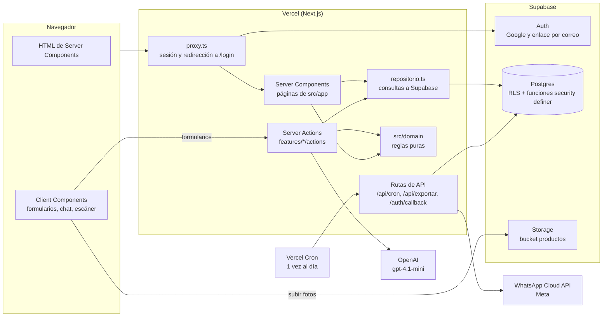

# Arquitectura de Lote

Cómo está armado el repo por dentro: el frontend, el servidor, la base de datos, las APIs y el SEO. Qué hace cada pantalla y en qué carpeta vive está en [FEATURES.md](FEATURES.md) (sección "Mapa del repo").

## La foto general

Lote es **una sola app de Next.js 16** (App Router, React 19, TypeScript) desplegada en **Vercel**, con **Supabase** como base de datos, autenticación y almacenamiento de fotos. No hay un backend aparte: el "back" son los Server Components, las Server Actions y unas pocas rutas de API que corren en el mismo proyecto, más las funciones de Postgres en Supabase.

## Frontend

- **Server Components por defecto.** Cada página de `src/app/` es delgada: lee los parámetros, pide los datos a la feature (`repositorio.ts`) y arma la pantalla. El HTML llega completo; `cacheComponents` está apagado a propósito para no llenar todo de `<Suspense>`.
- **`"use client"` solo donde hay interacción** (unos 120 archivos): formularios, el chat de Lotito, el escáner de códigos, el carrito, los modales. Va en la pieza más chica que lo necesita, no en la página entera.
- **Grupos de rutas** en `src/app/`:
  - `(panel)`: todo lo de quien vende (`/inicio`, `/productos`, `/pedidos`, `/gestion`, `/vender`…), con el menú y la burbuja de Lotito en su `layout.tsx`.
  - `(auth)`: el login. `(onboarding)`: crear el negocio, a pantalla completa.
  - Afuera de los grupos, lo público: `/` (landing), `/c/<tienda>` (vitrina), `/p/<pedido>` (seguimiento), `/marketplace`, `/ayuda`, `/privacidad`.
- **Estilos:** Tailwind 4 con tokens de marca en `src/app/globals.css` (colores, radios, sombras). Las reglas visuales están en [BRANDING.md](BRANDING.md). Fuentes con `next/font`: Plus Jakarta Sans para el texto y Fredoka para el logo.
- **Piezas compartidas:** `src/components/ui/` (botones, campos, tarjetas, `useToast()`, `useConfirmar()`), `src/components/nav/` (menú, encabezados, buscador ⌘K). Íconos solo por `Icon` (Lucide). Animaciones con `motion`; gráficos con `recharts` o barras hechas con HTML.
- **Textos:** todo lo que se lee en pantalla vive en `src/lib/textos/` (un archivo por tema, español salvadoreño con voseo). Los componentes no escriben textos sueltos.
- **Enlaces tipados** (`typedRoutes`): cada `href` se valida al compilar; las rutas con datos se arman con `ruta()` y `conBusqueda()` de `src/lib/ruta.ts`.
- **Mobile first:** botones de 44 px, una columna en celular y menú inferior flotante.

## Backend (dentro de Next)

### Las capas

| Capa | Dónde | Qué hace |
|---|---|---|
| Rutas | `src/app/` | Delgadas: params → feature → pantalla. Sin consultas directas ni lógica de negocio. |
| Features | `src/features/<tema>/` | `repositorio.ts` (consultas), `actions/` (Server Actions), `ui/` (componentes) y la lógica propia del tema, con pruebas al lado. |
| Dominio | `src/domain/` | Funciones puras: dinero, estados del pedido, ganancia, balance, fechas, promociones. **Todos los montos se calculan acá**, nunca en un componente ni en la IA. No importa nada de afuera. |
| Compartido | `src/lib/`, `src/components/` | Clientes de Supabase, formato, fotos, textos, piezas de interfaz. |

ESLint hace cumplir las fronteras (`eslint.config.mjs`): una feature no importa `ui/` ni `actions/` de otra (solo su repositorio y tipos), `components/` no conoce las features (salvo `components/nav/`, que es la carcasa) y `domain/` no importa nada.

### Cómo viaja una escritura

Ejemplo: registrar un gasto.

1. El formulario (Client Component) llama a la Server Action `agregarGasto` (`features/profit/actions/`).
2. La acción valida lo que escribió la persona (monto, categoría, fecha) y pide `negocioActual()` (`src/lib/negocio.ts`), que lee la sesión y el rol. Si no tiene permiso, devuelve el error sin tocar la base.
3. Llama al repositorio, que llama a una **función de Postgres** (`registrar_gasto`). La función vuelve a verificar el rol: esa es la autorización real.
4. `revalidatePath` refresca las pantallas que muestran ese dato.

Las acciones devuelven un estado (`{ error?, listo? }`) que el formulario muestra con `useActionState`; no lanzan errores hacia la interfaz.

### Sesión y permisos

- **`src/proxy.ts`** (el antiguo middleware) refresca la sesión de Supabase en cada petición y manda a `/login` a quien no tiene sesión, salvo en las rutas públicas (`PUBLICAS`). Es un filtro rápido, no la seguridad.
- **`negocioActual()`** (con `cache` de React) devuelve el negocio, el rol y lo que puede hacer (`puedeGestionar`, `puedeVender`). Decide qué se muestra.
- **La seguridad de verdad está en la base:** RLS en todas las tablas y funciones que verifican el rol (ver "Base de datos").
- Roles: dueña, administradora, vendedora y solo lectura. La tabla de permisos está en [FEATURES.md](FEATURES.md).

### Los cuatro clientes de Supabase (`src/lib/supabase/`)

| Cliente | Archivo | Para qué |
|---|---|---|
| Servidor con sesión | `server.ts` | Páginas y acciones del panel. Usa las cookies de la persona; RLS aplica. |
| Navegador | `client.ts` | Login (Google y enlace por correo) y subir fotos al bucket. |
| Público | `publico.ts` | Páginas públicas (`/c`, `/p`, `/marketplace`): solo llama a las funciones `vitrina_*` y `explorar_*`. Sin sesión. |
| Servicio | `servicio.ts` | Clave `service_role`, se salta RLS. Solo en el servidor (`server-only`): la tarea diaria, el mapa del sitio y las acciones públicas (apartar, comprar, reseñar). |

En las páginas de una tienda (`/c/<tienda>/*`), el negocio, el catálogo y el producto se piden con `negocioPublico`, `productosPublicos` y `productoPublico` (`features/catalog/publico.ts`): están memoizados con `cache` de React por slug, así que el layout, `generateMetadata` y la página comparten una sola consulta por visita.

### Acciones públicas (vitrina)

Apartar, comprar, reseñar y "avisame cuando haya" no tienen sesión, así que se protegen de otra forma (`features/catalog/actions/`):

- **Campo trampa:** un campo escondido (`sitio_web`); si viene lleno, es un robot y no se crea nada.
- **Límite de intentos:** el servidor calcula una huella del dispositivo (hash del IP con `HUELLA_SECRETO`, en `features/catalog/dispositivo.ts`) y la base cuenta los intentos en `intento_publico`.
- **El navegador no puede llamar esas funciones directo** (`cerrar_publicas.sql`): solo el servidor, con el cliente de servicio, para que la huella no se pueda inventar.

### Secretos

Los archivos que leen claves (`SUPABASE_SERVICE_ROLE_KEY`, `OPENAI_API_KEY`, `WHATSAPP_TOKEN`, `HUELLA_SECRETO`) importan `server-only`: si algo del navegador los importa, el build falla. Ninguna clave secreta lleva el prefijo `NEXT_PUBLIC_`. Las variables están listadas en el [README](../README.md).

## Base de datos (Supabase)

- **Postgres con RLS en todas las tablas.** Las tablas se leen con políticas (`puede_gestionar`, `es_miembro`, `rol_en`…) y **no se escriben directo**: toda escritura pasa por funciones `security definer` que verifican el rol y hacen la operación completa en una transacción (por ejemplo `registrar_pedido`, `registrar_pago`, `vender_mostrador`, `abonar_pasivo`).
- **Las reglas críticas viven también en SQL** (además de `src/domain/`), porque solo la base garantiza la concurrencia: el bloqueo de doble apartado, el stock disponible, el límite de intentos.
- **Una venta cuenta cuando el pedido se paga completo**, y el costo de cada ítem se congela al crear el pedido.
- **Storage:** bucket público `productos`, con las fotos en `<negocio_id>/<archivo>.webp`. El navegador las comprime y las sube; la tarea diaria borra las que nadie usa.
- **El SQL vive en `supabase/*.sql`** y se corre a mano en el SQL Editor, cada archivo una vez y en orden; varias funciones se vuelven a crear en archivos posteriores y gana la última. Para leer cómo está la base hoy sin recorrer los 70+ archivos: [esquema_actual.sql](esquema_actual.sql), que se arma con `pnpm esquema` (también avisa lo que está en la base y en ningún archivo).
- **Tipos:** `src/lib/supabase/database.types.ts`, generados desde la base. Los clientes los usan, así que una columna mal escrita no compila.
- **Fechas:** el día se cuenta en hora de El Salvador (`hoy_el_salvador()` en la base, `fechaLocalDe` en el código), no en UTC.

## APIs

### Propias (rutas de Next)

| Ruta | Quién la llama | Qué hace |
|---|---|---|
| `GET /api/cron/avisos` | Vercel Cron, una vez al día (`vercel.json`), con `Authorization: Bearer <CRON_SECRET>` | Vence los apartados, genera y manda los avisos por WhatsApp, pone al día las ofertas con fechas, registra los gastos fijos de todos los negocios y borra las fotos sueltas. |
| `GET /api/exportar/<tipo>` | El panel (Ajustes → Exportar) | Descarga productos, pedidos, clientes o gastos en CSV. Solo dueña y administradora. |
| `GET /auth/callback` | Supabase Auth, al volver de Google o del enlace por correo | Cambia el código por la sesión y entra al panel. |

Todo lo demás (crear, editar, cobrar) son **Server Actions**, no rutas de API.

### Externas

- **OpenAI** (`features/ai/`, modelo `gpt-4.1-mini`, cambiable con `ASISTENTE_MODELO`): entender los mensajes del chat, leer la foto de un producto, leer un comprobante de transferencia y conversar con los datos del negocio. Salida estructurada con esquemas de Zod y `store: false`. **La IA solo interpreta**: devuelve la intención y los datos, y el código decide y calcula. Sin `OPENAI_API_KEY`, el chat sigue respondiendo "ayuda" y "deshacer".
- **WhatsApp Cloud API de Meta** (`features/whatsapp/`): seis plantillas de avisos, con una cola en la base que la tarea diaria vacía. Con `WHATSAPP_CANAL=consola` imprime los mensajes en vez de mandarlos (para la demo). Falta el webhook de entrada.

### Lotito por dentro (`features/assistant/`)

`actions/enviar.ts` recibe el mensaje → `motor.ts` resuelve atajos sin IA y, si no, le pregunta a la IA la intención → cada intención (`intenciones/`: pedido, cobro, gasto, producto, consulta, conversar) ejecuta con el **puerto** (`puertoSupabase.ts`, una interfaz que en las pruebas se reemplaza por uno falso) → cada acción guarda cómo deshacerse (`accion` en la base). Lo delicado se confirma con botones antes de ejecutarse.

## SEO

- **Metadata:** el layout raíz define el título por plantilla (`%s · Lote`), la descripción, Open Graph (`es_SV`) y Twitter. Las páginas públicas con datos usan `generateMetadata`: la vitrina, el producto, el Marketplace y sus categorías.
- **Imágenes para compartir:** `opengraph-image.tsx` generadas en el servidor para la landing, el Marketplace, cada vitrina y cada producto (con las fuentes de `assets/fuentes/`), recalculadas cada hora. También `apple-icon`, `icon.svg` y `manifest.ts`.
- **Datos estructurados (JSON-LD)** con `src/lib/jsonld.tsx`: la landing, la ayuda (preguntas frecuentes), la vitrina (la tienda), cada producto (con precio, disponibilidad y reseñas) y el Marketplace.
- **`sitemap.ts`:** las páginas fijas, las categorías del Marketplace y, de cada tienda con productos disponibles, su vitrina y cada producto (las variantes de un producto van una sola vez). Se recalcula cada hora.
- **`robots.ts`:** se indexa `/`, `/c/`, `/marketplace` y `/ayuda`; el panel, el login, `/api`, `/p/` (seguimiento privado) y `/admin` no.
- **URL canónica:** `src/lib/sitio.ts` (`https://lote-ten.vercel.app`, cambiable con `NEXT_PUBLIC_SITE_URL`).
- **Direcciones viejas** (`/explorar`, `/ganancia`, `/dinero`, `/mostrador`…) redirigen con 308 desde `next.config.ts`, para no perder lo que ya indexaron los buscadores.

## Pruebas y calidad

- **Vitest**, con las pruebas al lado del código (`*.test.ts`): sobre todo `src/domain/`, los repositorios y el motor de Lotito. `src/test/supabaseFalso.ts` es un Supabase de mentira para probar repositorios y acciones sin red.
- Las pruebas contra OpenAI real (`openai.live.test.ts`) se saltan salvo con `RUN_LIVE_AI=1`, porque cuestan dinero.
- Verificación: `npx tsc --noEmit`, `npx eslint src`, `npx vitest run`, `npx next build`.

## Despliegue

- **Vercel** (plan Hobby): un solo proyecto, una tarea programada al día.
- **Supabase:** el SQL se aplica a mano. `cron.sql` (vencer apartados con `pg_cron`, más seguido) es opcional y no está corrido; mientras tanto, los apartados los vence la tarea diaria.
- **Scripts locales** (`scripts/`, con `pnpm`): datos de prueba (`semilla`), limpiar fotos (`fotos-sueltas`), generar ilustraciones con OpenAI (`imagenes-*`) y el esquema (`esquema`). No corren en producción.
